# Cuffless BP Monitor

Cuffless, non-invasive blood-pressure monitoring using **Pulse Transit Time (PTT)**: one
AD8232 ECG gives the timing reference (the R-peak), and four MAX30102 PPG sensors on a
TCA9548A I²C multiplexer pick up the pulse wave at fingertips and earlobes. An ESP32
samples everything, filters it, and streams the waveforms.

This repository holds the carrier PCB (KiCad 9), the ESP32 firmware, and the
[project report](docs/Cuffless_BP_Monitor_Report.docx).

> **Not a medical device.** For research and education only; not validated for clinical use.

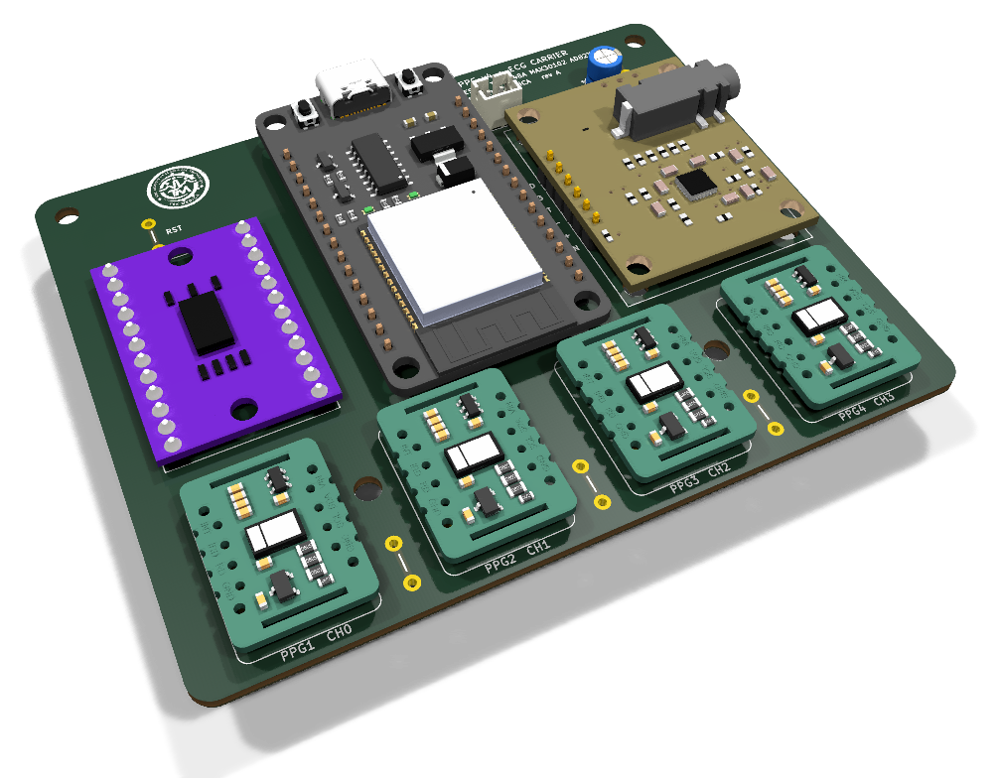

## How it works

Each heartbeat shows up as an R-peak on the ECG (t = 0). The pressure pulse it launches
reaches a peripheral site a short time later, where a PPG sensor sees it. That delay is the
PTT. Higher blood pressure stiffens the arteries, the pulse travels faster, and PTT gets
shorter:

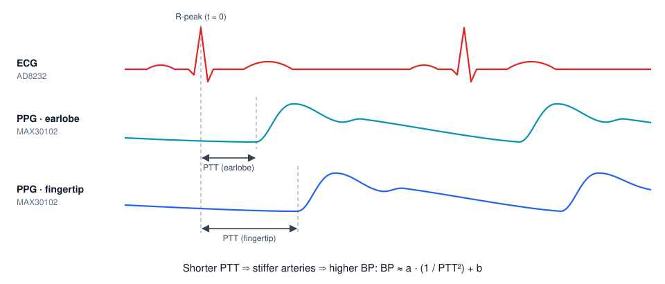

```
BP ≈ a · (1 / PTT²) + b
```

`a` and `b` are fitted per person against a reference cuff. Using a proximal site
(earlobe, short PTT) and distal sites (fingertips, longer PTT) gives several transit times
per beat, for cross-checking and rejecting motion artefacts.

## System overview

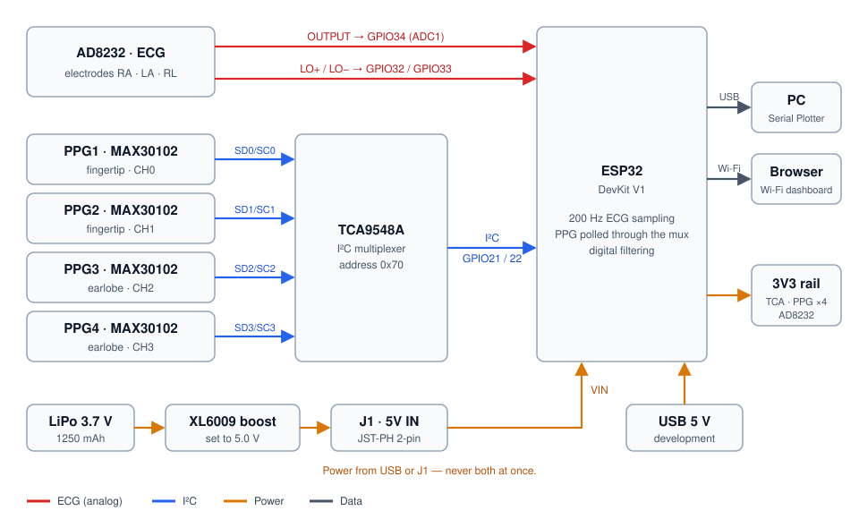

The ECG is analog, so it goes straight to an ADC1 pin and keeps working with Wi-Fi on.
All four MAX30102 sensors share I²C address 0x57, so the TCA9548A connects one at a time.

## Hardware

### Carrier board

| | |
|---|---|
| Size | 95.5 × 76 mm, 4 × M3 holes |
| Copper | Single-sided (bottom), through-hole only, no vias. Built to be etched at home |
| Tracks | 0.5 mm signal, 0.8 mm power, ≥ 0.6 mm clearance, ground pour |
| Pads | 1.9 mm pads on 1.0 mm holes, sized for a hand drill |
| Power in | USB on the ESP32, or J1 (JST-PH 2-pin) → ESP32 VIN |

The four PPG sockets sit in one straight row, PPG1–PPG4 left to right on mux channels 0–3.
The bottom copper, seen from the component side:

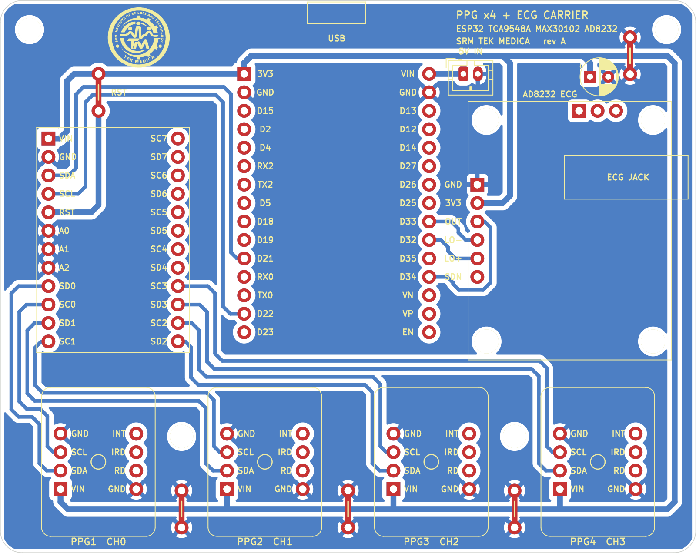

### Renders

<table>
  <tr>
    <td>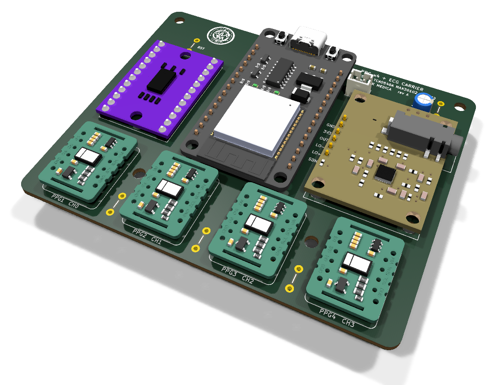</td>
    <td>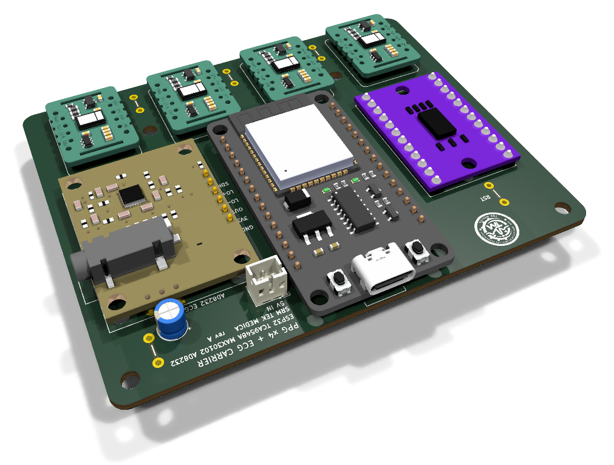</td>
  </tr>
  <tr>
    <td align="center">Assembled, front right</td>
    <td align="center">Assembled, from the back: USB, 5V IN and the ECG jack</td>
  </tr>
  <tr>
    <td colspan="2">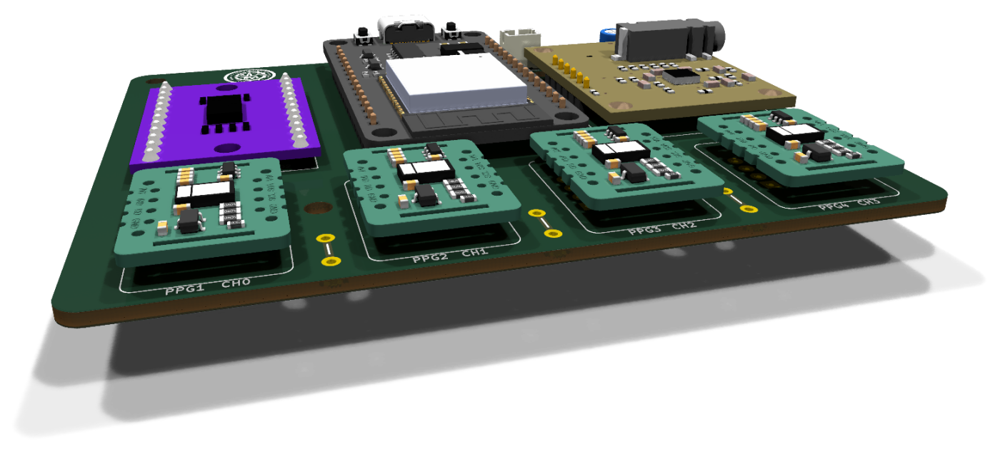</td>
  </tr>
  <tr>
    <td colspan="2" align="center">The four PPG sockets, PPG1&ndash;PPG4 on mux channels 0&ndash;3</td>
  </tr>
  <tr>
    <td>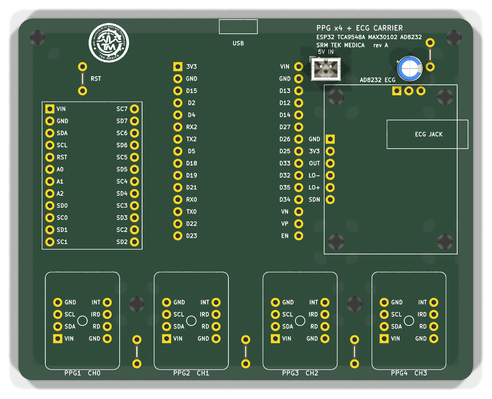</td>
    <td>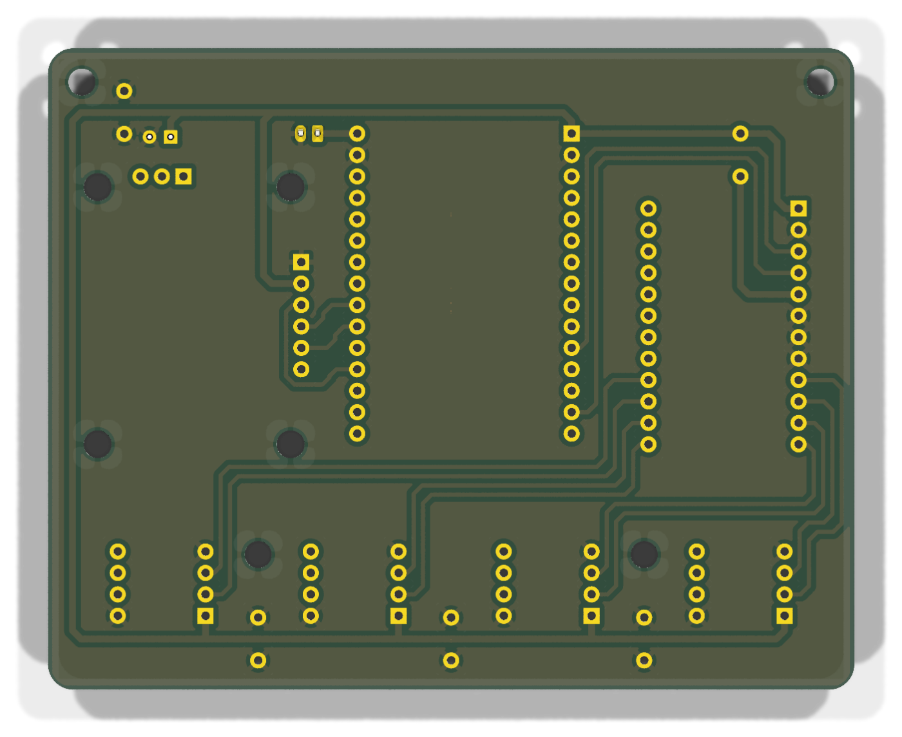</td>
  </tr>
  <tr>
    <td align="center">Bare board, top: silkscreen and pin names</td>
    <td align="center">Bare board, bottom: the single copper layer</td>
  </tr>
  <tr>
    <td colspan="2">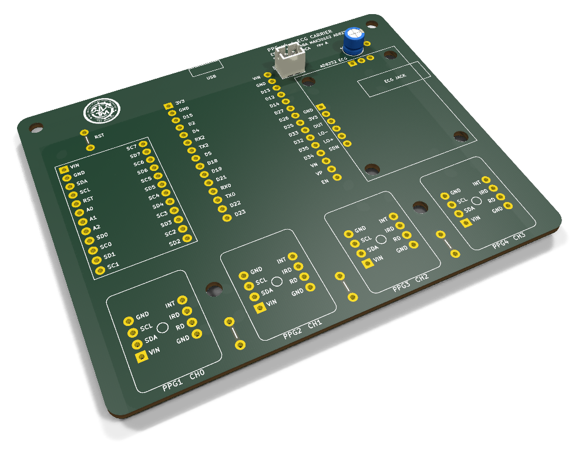</td>
  </tr>
  <tr>
    <td colspan="2" align="center">Bare board before the modules go on</td>
  </tr>
</table>

### Parts

| Ref | Part | Qty | Purpose |
|---|---|---|---|
| U1 | ESP32 DevKit V1, 30-pin (CP2102) | 1 | Acquisition, DSP, telemetry |
| U2 | TCA9548A I²C mux module (HW-617) | 1 | Addresses the four identical sensors |
| U3–U6 | MAX30102 module (MH-ET LIVE) | 4 | PPG: 2 fingers, 2 earlobes |
| U7 | SparkFun AD8232 (SEN-12650) + electrodes | 1 | ECG / R-peak reference |
| J1 | JST-PH 2-pin, vertical | 1 | 5 V input |
| C1 | 10 µF electrolytic | 1 | 3V3 bulk decoupling |
| JP1–JP5 | Bare-wire links | 5 | Jumpers for the single copper layer |

For portable use: a 3.7 V LiPo (1250 mAh) and an XL6009 boost converter set to 5.0 V, with
470 µF + 0.1 µF across both its input and its output. Full list:
[`hardware/docs/bom.csv`](hardware/docs/bom.csv).

### Pin map

| Module pin | ESP32 |
|---|---|
| TCA9548A VIN / GND | 3V3 / GND |
| TCA9548A SDA / SCL | GPIO21 / GPIO22 |
| TCA9548A A0, A1, A2 | GND (address 0x70) |
| TCA9548A RST | 3V3 (through link JP5) |
| MAX30102 #1 (finger) SDA / SCL | mux SD0 / SC0 |
| MAX30102 #2 (finger) SDA / SCL | mux SD1 / SC1 |
| MAX30102 #3 (earlobe) SDA / SCL | mux SD2 / SC2 |
| MAX30102 #4 (earlobe) SDA / SCL | mux SD3 / SC3 |
| AD8232 OUTPUT | GPIO34 (ADC1, works with Wi-Fi on) |
| AD8232 LO+ / LO− | GPIO32 / GPIO33 |
| AD8232 3.3V / GND | 3V3 / GND |
| AD8232 SDN, MAX30102 INT / RD / IRD | not connected |

All MAX30102 VIN pins go to 3V3 and all grounds are common. Electrodes: RA on the right
collarbone, LA on the left collarbone, RL (reference) on the left lower rib.

### Schematic

[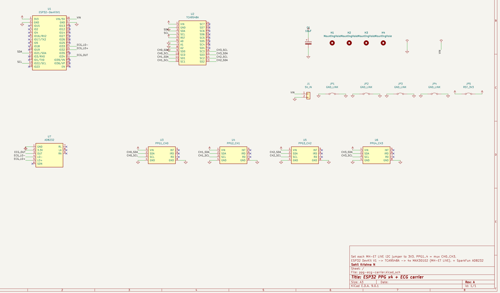](hardware/docs/schematic.pdf)

Click the image for the PDF.

### Assembly notes

- Fit the wire links first. JP1–JP4 join ground areas that the single layer splits apart,
  and JP5 carries 3V3 to the mux RST pin over the SDA/SCL tracks.
- Set the I²C level jumper on each MH-ET LIVE module to **3V3**.
- J1 pin 1 (rounded-square pad, by the **5V IN** label) takes 5 V. Pin 2 is GND. Feed it from the XL6009
  set to exactly 5.0 V. Check the voltage with a meter before connecting it.
- **Never power the board from USB and J1 at the same time.** Flash over USB first, then
  switch to battery.

## Firmware

[`firmware/cuffless_bp_monitor/cuffless_bp_monitor.ino`](firmware/cuffless_bp_monitor/cuffless_bp_monitor.ino)
is an Arduino sketch for the ESP32 core. It needs nothing beyond `Wire.h`.

- Runs a 200 Hz processing loop and prints at 50 Hz over USB serial at 115200 baud. Each
  line is the ECG value followed by each detected PPG channel, tab-separated, so it works
  directly in the Arduino Serial Plotter.
- Finds sensors at start-up by part ID (0x15) and skips channels with no sensor.
- Selects the mux channel before each PPG read (ch0 = 0x01 … ch3 = 0x08).

| Stage | Technique | Removes |
|---|---|---|
| Hardware averaging | MAX30102 sample-average ×4 | Random sensor noise |
| Oversampling | 16× ADC average (ECG) | ADC jitter |
| Median | Median-of-3 (PPG) | Motion spikes |
| High-pass | Slow EMA baseline subtraction | Baseline wander, DC drift |
| Notch | 2nd-order IIR biquad (ECG) | Mains hum (`MAINS_HZ`, 50 or 60) |
| Low-pass | 2-pole cascaded EMA | High-frequency fuzz |
| Gain | Software gain + clamp | Scales the clean signal |

Tuning constants are grouped at the top of the sketch. Set `MAINS_HZ` to your local mains
frequency.

The Wi-Fi web dashboard described in the report is not in this repository yet. This
sketch streams over USB only.

## Repository layout

```
hardware/              KiCad 9 project (ppg-ecg-carrier)
  lib/                 footprints, symbols, logo
  fab/                 Gerbers + Excellon drill file
  docs/                renders, schematic, etch / assembly / drill PDFs, BOM
firmware/              ESP32 Arduino sketch
docs/                  project report
```

## Opening the design

Open `hardware/ppg-ecg-carrier.kicad_pro` in KiCad 9. The footprints and symbols for
the four modules are in the project's own library (`hardware/lib/`), so nothing else
needs installing.

### 3D models

The STEP models of the four modules are third-party files and are not included. To see
them in KiCad's 3D viewer, put these files in `hardware/lib/3d/`:

- `esp32_30pin.step`
- `TCA9548.stp`
- `MAX30102_MH_ET_LIVE_BOARD_v8.step`
- `AD8232_Heart_Rate_Monitor v4.step`

## Fabrication

- **Home etching:** print [`hardware/docs/etch-bottom.pdf`](hardware/docs/etch-bottom.pdf)
  at 100 % scale. It is already mirrored for toner transfer.
- **Drilling:** [`drill-map.pdf`](hardware/docs/drill-map.pdf) shows the holes. Fit the
  parts using [`assembly-top.pdf`](hardware/docs/assembly-top.pdf).
- **Fab house:** upload [`hardware/fab/`](hardware/fab) as a 2-layer board. The top-copper
  Gerber holds only the five wire links, drawn as tracks, so a fabbed board needs no
  wire links.

## Limitations

- PTT-based BP needs per-person calibration against a cuff and drifts over time. Treat it
  as a trend monitor.
- The PPG sensors are read one at a time through the mux, so their timing has to be
  reconstructed in software.
- The ESP32's internal ADC is noisy. Oversampling helps, but an external ADC would give a
  cleaner ECG.
- Both signals are sensitive to motion and to poor electrode or sensor contact.

## Roadmap

1. R-peak detection on the ECG (Pan–Tompkins-style thresholding)
2. Pulse-foot detection on each PPG channel
3. PTT per site and per beat: t(PPG foot) − t(ECG R-peak)
4. Calibration against a reference cuff to fit `a` and `b`
5. On-device BP calculation, transmitting only the result
6. OTA updates and a wearable enclosure

## Author

**Sahil Krishna N** ([@Gene0Grey](https://github.com/Gene0Grey))
